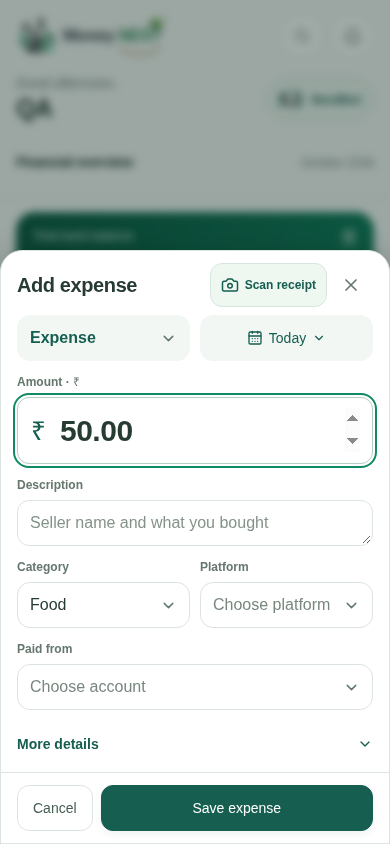
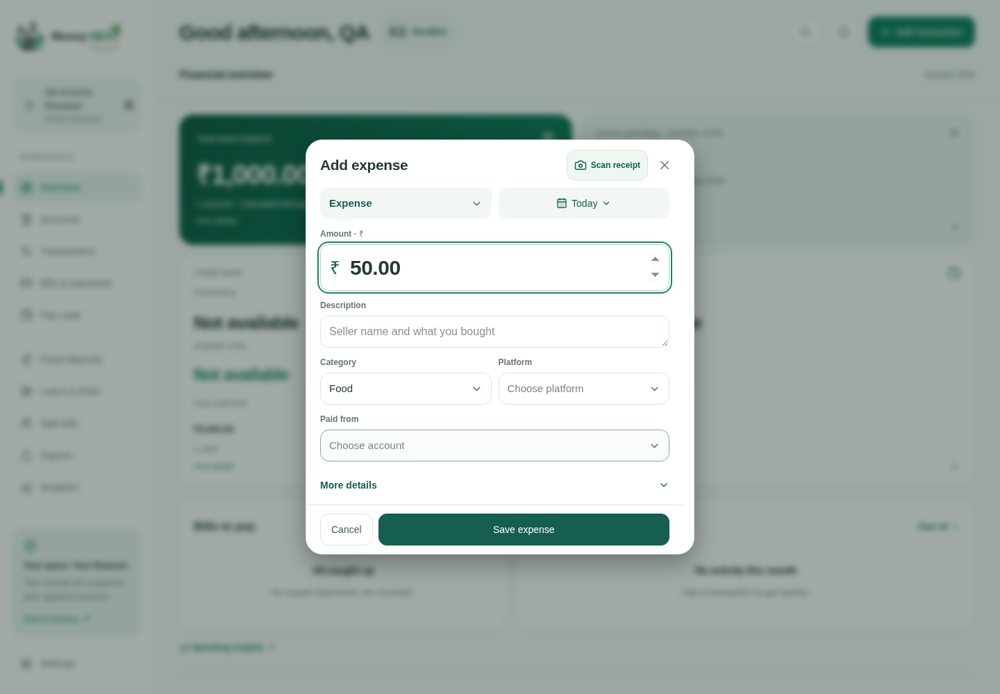

# Compact expense editor — visual review

All images are real Chromium captures of a **fictional QA workspace**. No user export, real transaction, profile or screenshot was included. Test dates are fixed to 22 October 2026; production date selection remains dynamic.

Before captures use the unchanged production build at `34a5ced`. After captures use the compact editor production build, with Food selected to exercise category/platform interaction. Both use a fictional ₹50 input solely to show the amount field.

| Width | Before | After | Account picker |
| --- | --- | --- | --- |
| 320px | [Before](before/320px/add-expense.png) | [After](after/320px/add-expense.png) | [Picker](after/320px/account-picker.png) |
| 390px | [Before](before/390px/add-expense.png) | [After](after/390px/add-expense.png) | [Picker](after/390px/account-picker.png) |
| 1440px | [Before](before/1440px/add-expense.png) | [After](after/1440px/add-expense.png) | [Picker](after/1440px/account-picker.png) |

The mobile editor now shows its essential fields and Save action together, with a single Scan receipt action. The account list scrolls internally; additional options, including Someone else paid, remain reachable. Desktop uses the same controls in a centered dialog.

Nine captures are listed with dimensions and hashes in [manifest.json](manifest.json). Responsive assertions also ran at 360, 375, 412, 430, 768 and 1024px. Physical-device software keyboards and installed-PWA behavior remain manual checks.
